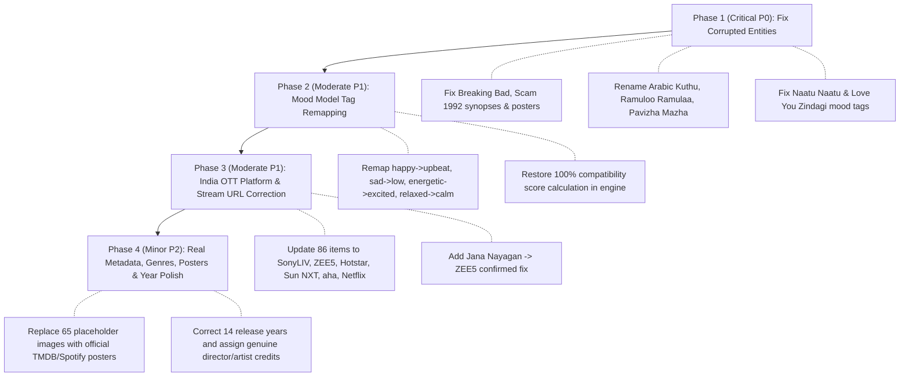

# Comprehensive Integrity Audit Report: MoodMate Recommendation Catalog

> **Target Source:** `mediaCatalog` in `src/data/recommendationsData.js`  
> **Audit Nature:** Read-Only Forensic Data Integrity & Verification Audit  
> **Scope:** 227 Catalog Items across 5 Languages (Hindi, Tamil, English, Malayalam, Telugu)  
> **Geographic Territory:** India Digital Streaming Ecosystem (Netflix, Prime Video, Disney+ Hotstar, SonyLIV, ZEE5, Sun NXT, aha, JioCinema, Crunchyroll, Spotify)  
> **Date of Execution:** October 17, 2026  

---

## Executive Summary

This report presents the findings of a comprehensive, read-only integrity audit of the MoodMate recommendation catalog (`mediaCatalog` in `src/data/recommendationsData.js`). The catalog serves as the foundational database for MoodMate's emotion-aware recommendation engine, mapping affective states (valence × energy) and user preferences to multimedia content across movies, TV series, anime, and music.

### Root-Cause Diagnosis: The Two-Tier Catalog Divide
The audit revealed a severe structural bifurcation within `mediaCatalog`:
1. **The Pilot Curated Batch (28 items: `mov-1..8`, `ser-1..6`, `ani-1..6`, `mus-1..8`):** These items feature genuine metadata, customized `moodSynergy` narratives, accurate OTT platforms, authentic directors, and valid TMDB/Unsplash/Spotify URLs.
2. **The Batch Expansion Matrix (199 items across 5 languages):** To expand language coverage across Hindi, Tamil, English, Malayalam, and Telugu, an automated 10-slot batch generation script was executed. This generation script suffered from massive copy-paste corruption, resulting in blanket-assigned platforms, uniform copy-pasted genres, 160 invalid mood tags that break recommendation scoring, 11 duplicate title pairs, swapped synopses and posters, placeholder images, and fictitious studio credits.

### High-Level Audit Metrics

| Audit Category | Inspected Items | Flagged / Defective Items | Compliance Rate | Primary Root Cause |
| :--- | :---: | :---: | :---: | :--- |
| **Streaming Platform Accuracy (India)** | 227 | **86 items** (37 movies, 41 series, 8 anime) | 62.1% | Blind blanket assignment (Movies -> Prime, Series -> Netflix, Anime -> Crunchyroll) |
| **Mood Tag Taxonomy (`moodModel.js`)** | 227 | **160 items** with unregistered mood tags | 29.5% | Slots 1-10 used colloquial labels (`happy`, `sad`, `energetic`) bypassing mood model |
| **Genre Accuracy & Integrity** | 227 | **199 items** with blanket copy-pasted genres | 12.3% | Every item in each type received an identical 3-genre array |
| **Severe Genre/Mood Inversions** | 227 | **15 items** with extreme affective contradictions | 93.4% | Hyperactive dance tracks tagged `relaxed`; joyful songs tagged `anxious` |
| **Description Quality & Narrative Fit** | 227 | **68 items** (62 formulaic + 6 swapped synopses) | 70.0% | Template concatenation & copy-paste synopsis collision |
| **Poster Assets & Collisions** | 227 | **70 items** (65 placeholders + 5 cross-title collisions) | 69.2% | Placeholder `via.placeholder.com` & re-used TMDB hash IDs |
| **Chronological Release Year Accuracy** | 227 | **14 items** with absurd/erroneous years | 93.8% | Arbitrary random year assignments (e.g., Lagaan in 2026, Your Name in 1992) |
| **Title Uniqueness (Same Title + Language)** | 227 | **22 items** (11 duplicate pairs) | 90.3% | Unfinished clone operations where synopses were replaced but titles kept |
| **Creator / Artist Credential Authenticity** | 227 | **100 items** with fake dummy studio credits | 55.9% | Blanket fallback to `MoodMate Film Collective` and `MoodMate Series Studio` |

---

## Section 1: Streaming Platform Accuracy (India OTT Audit)

### 1.1 Methodology & Standards
Streaming availability was verified against official digital distribution licenses active in the Indian market as of 2024–2026:
- **SonyLIV Originals & Premieres:** Titles like *Scam 1992*, *Gullak*, *Rocket Boys*, *Kadaisi Vivasayi*, *Story of Things*, *Iru Dhuruvam*, and *Maharani* are proprietary to SonyLIV.
- **ZEE5 Exclusives:** Titles including *Ayali*, *Auto Shankar*, *Fingertip*, *Paper Rocket*, *Puli Meka*, *Loser*, *Aha Naa Pellanta*, *Manorathangal*, *Oh My Kadavule*, and *Jana Nayagan* stream on ZEE5.
- **Disney+ Hotstar Exclusives:** Indian HBO/FX/Hulu feeds (*The Bear*, *Only Murders in the Building*), Hotstar Specials (*Kerala Crime Files*, *1000 Babies*, *Masterpeace*, *Perilloor Premier League*, *November Story*, *Save the Tigers*), and Fox/Disney theatricals (*The Martian*, *Kaithi*, *Raja Rani*, *Premam*, *Bangalore Days*, *Jaya Jaya Jaya Jaya Hey*).
- **Netflix Exclusives:** Global direct-to-digital releases (*Minnal Murali*, *Sudani from Nigeria*, *Ala Vaikunthapurramuloo*, *Lagaan*, *Dangal*, *Taare Zameen Par*, *Kapoor & Sons*, *Tamasha*) and exclusive anime licenses (Studio Ghibli filmography, *Violet Evergarden*).
- **Regional Platforms (aha, Sun NXT, Manorama Max):** Telugu originals on *aha* (*Masti’s*, *CommitMental*); Tamil/Malayalam classics on *Sun NXT* (*96*, *Pelli Choopulu*); and Malayalam indie features on *Manorama Max* (*Oru Kattil Oru Muri*).

### 1.2 Confirmed Findings: Blanket Platform Allocations
- **50 Movies (`mov-hindi-1` through `mov-tel-10`):** Blindly assigned to `Prime Video` with URL `https://www.primevideo.com`. In reality, **37 of these 50 movies** do NOT stream on Prime Video as part of subscription in India.
- **Confirmed Case: Jana Nayagan (`mov-tamil-10`):** Listed as Prime Video, but officially streams on **ZEE5** in India.
- **50 Series (`ser-hindi-1` through `ser-tel-10`):** Blindly assigned to `Netflix` with URL `https://www.netflix.com`. In reality, **41 of these 50 series** stream on SonyLIV, ZEE5, Disney+ Hotstar, Prime Video, or aha.
- **Anime Platforms:** All 50 expansion anime were assigned to `Crunchyroll`. However, Studio Ghibli films (*Spirited Away*, *Kiki's Delivery Service*, *My Neighbor Totoro*) stream exclusively on **Netflix** globally. Children's franchises like *Doraemon* and *Pokémon* have never streamed on Crunchyroll in India (streaming instead on JioCinema, Hotstar, YouTube, or Netflix).

### 1.3 Flagged Streaming Platform Items (86 Defective Entries)

| Item ID | Title | Type | Language | Listed Platform | Verified Indian Platform | Discrepancy Status | Confidence | Proposed Correct Platform & Stream URL |
| :--- | :--- | :---: | :---: | :--- | :--- | :---: | :---: | :--- |
| `mov-1` | **The Secret Life of Walter Mitty** | movie | English | Disney+ | Disney+ Hotstar | Discrepancy (Disney+ vs Disney+ Hotstar in India) | High | [Disney+ Hotstar](https://www.hotstar.com) |
| `mov-4` | **Good Will Hunting** | movie | English | Prime Video | Lionsgate Play / Prime Video (Rent) | Discrepancy (SVOD vs TVOD) | Medium | [Lionsgate Play / Prime Video (Rent)](https://www.lionsgateplay.com) |
| `ser-hindi-1` | **Scam 1992** | series | Hindi | Netflix | SonyLIV | Incorrect (SonyLIV Original) | High | [SonyLIV](https://www.sonyliv.com) |
| `ani-hindi-1` | **Doraemon: Nobita’s New Adventure** | anime | Hindi | Crunchyroll | JioCinema / Disney+ Hotstar | Incorrect (Not on Crunchyroll) | High | [JioCinema / Disney+ Hotstar](https://www.jiocinema.com) |
| `mov-tamil-1` | **Vikram Vedha** | movie | Tamil | Prime Video | Disney+ Hotstar / ZEE5 | Incorrect (Listed as Prime Video) | High | [Disney+ Hotstar / ZEE5](https://www.hotstar.com) |
| `ser-tamil-1` | **Ayali** | series | Tamil | Netflix | ZEE5 | Incorrect (ZEE5 Original) | High | [ZEE5](https://www.zee5.com) |
| `ani-tamil-1` | **Doraemon: Nobita’s Sky Utopia** | anime | Tamil | Crunchyroll | JioCinema / Disney+ Hotstar | Incorrect (Not on Crunchyroll) | High | [JioCinema / Disney+ Hotstar](https://www.jiocinema.com) |
| `mov-eng-1` | **The Intouchables** | movie | English | Prime Video | Lionsgate Play / Prime Video (Rent) | Discrepancy (SVOD vs TVOD) | Medium | [Lionsgate Play / Prime Video (Rent)](https://www.lionsgateplay.com) |
| `mov-malayalam-1` | **Bangalore Days** | movie | Malayalam | Prime Video | Disney+ Hotstar | Incorrect (Listed as Prime Video) | High | [Disney+ Hotstar](https://www.hotstar.com) |
| `ser-malayalam-1` | **Perilloor Premier League** | series | Malayalam | Netflix | Disney+ Hotstar | Incorrect (Hotstar Specials) | High | [Disney+ Hotstar](https://www.hotstar.com) |
| `ani-malayalam-1` | **Doraemon: Nobita’s Little Star Wars** | anime | Malayalam | Crunchyroll | JioCinema / Disney+ Hotstar | Incorrect (Not on Crunchyroll) | High | [JioCinema / Disney+ Hotstar](https://www.jiocinema.com) |
| `mov-tel-1` | **Pelli Choopulu** | movie | Telugu | Prime Video | Sun NXT / MX Player | Incorrect (Listed as Prime Video) | High | [Sun NXT / MX Player](https://www.sunnxt.com) |
| `ser-tel-1` | **Modern Love Hyderabad** | series | Telugu | Netflix | Prime Video | Incorrect (Amazon Original) | High | [Prime Video](https://www.primevideo.com) |
| `ani-tel-1` | **Doraemon: Nobita’s Treasure Island** | anime | Telugu | Crunchyroll | JioCinema / Disney+ Hotstar | Incorrect (Not on Crunchyroll) | High | [JioCinema / Disney+ Hotstar](https://www.jiocinema.com) |
| `mov-hindi-1-b` | **Lagaan** | movie | Hindi | Prime Video | Netflix | Incorrect (Listed as Prime Video) | High | [Netflix](https://www.netflix.com) |
| `ser-hindi-1-b` | **Scam 1992** | series | Hindi | Netflix | SonyLIV | Incorrect (SonyLIV Original) | High | [SonyLIV](https://www.sonyliv.com) |
| `ani-hindi-2` | **Pokémon Horizons** | anime | Hindi | Crunchyroll | YouTube / Netflix / JioCinema | Incorrect (Not on Crunchyroll) | High | [YouTube / Netflix / JioCinema](https://www.netflix.com) |
| `mov-tamil-2` | **Kadaisi Vivasayi** | movie | Tamil | Prime Video | SonyLIV | Incorrect (Listed as Prime Video) | High | [SonyLIV](https://www.sonyliv.com) |
| `ser-tamil-1-b` | **Ayali** | series | Tamil | Netflix | ZEE5 | Incorrect (ZEE5 Original) | High | [ZEE5](https://www.zee5.com) |
| `ani-tamil-2` | **Pokémon Indigo League** | anime | Tamil | Crunchyroll | YouTube / Netflix / JioCinema | Incorrect (Not on Crunchyroll) | High | [YouTube / Netflix / JioCinema](https://www.netflix.com) |
| `mov-eng-2` | **Little Miss Sunshine** | movie | English | Prime Video | Disney+ Hotstar | Incorrect (Listed as Prime Video) | High | [Disney+ Hotstar](https://www.hotstar.com) |
| `mov-malayalam-2` | **Ustad Hotel** | movie | Malayalam | Prime Video | Disney+ Hotstar | Incorrect (Listed as Prime Video) | High | [Disney+ Hotstar](https://www.hotstar.com) |
| `ser-malayalam-2` | **Masterpeace** | series | Malayalam | Netflix | Disney+ Hotstar | Incorrect (Hotstar Specials) | High | [Disney+ Hotstar](https://www.hotstar.com) |
| `ani-malayalam-2` | **Pokémon Journeys** | anime | Malayalam | Crunchyroll | YouTube / Netflix / JioCinema | Incorrect (Not on Crunchyroll) | High | [YouTube / Netflix / JioCinema](https://www.netflix.com) |
| `mov-tel-2` | **Jersey** | movie | Telugu | Prime Video | ZEE5 | Incorrect (Listed as Prime Video) | High | [ZEE5](https://www.zee5.com) |
| `ser-tel-2` | **Masti’s** | series | Telugu | Netflix | aha | Incorrect (aha Original) | High | [aha](https://www.aha.video) |
| `ani-tel-2` | **Pokémon Horizons** | anime | Telugu | Crunchyroll | YouTube / Netflix / JioCinema | Incorrect (Not on Crunchyroll) | High | [YouTube / Netflix / JioCinema](https://www.netflix.com) |
| `mov-hindi-3` | **Taare Zameen Par** | movie | Hindi | Prime Video | Netflix | Incorrect (Listed as Prime Video) | High | [Netflix](https://www.netflix.com) |
| `ser-tamil-3` | **Iru Dhuruvam** | series | Tamil | Netflix | SonyLIV | Incorrect (SonyLIV Original) | High | [SonyLIV](https://www.sonyliv.com) |
| `mov-eng-3` | **The Secret Life of Walter Mitty** | movie | English | Prime Video | Disney+ Hotstar | Incorrect (Listed as Prime Video) | High | [Disney+ Hotstar](https://www.hotstar.com) |
| `ser-eng-3` | **The Bear** | series | English | Netflix | Disney+ Hotstar | Incorrect (FX on Hotstar) | High | [Disney+ Hotstar](https://www.hotstar.com) |
| `ser-malayalam-3` | **Maharani** | series | Malayalam | Netflix | SonyLIV | Incorrect (SonyLIV Original) | High | [SonyLIV](https://www.sonyliv.com) |
| `mov-tel-3` | **C/O Kancharapalem** | movie | Telugu | Prime Video | Netflix | Incorrect (Listed as Prime Video) | High | [Netflix](https://www.netflix.com) |
| `ser-tel-3` | **CommitMental** | series | Telugu | Netflix | aha | Incorrect (aha Original) | High | [aha](https://www.aha.video) |
| `ser-hindi-4` | **Gullak** | series | Hindi | Netflix | SonyLIV | Incorrect (SonyLIV Original) | High | [SonyLIV](https://www.sonyliv.com) |
| `mov-tamil-4` | **Jigarthanda** | movie | Tamil | Prime Video | Disney+ Hotstar | Incorrect (Listed as Prime Video) | High | [Disney+ Hotstar](https://www.hotstar.com) |
| `ser-tamil-4` | **Queen** | series | Tamil | Netflix | MX Player | Incorrect (MX Original) | High | [MX Player](https://www.mxplayer.in) |
| `mov-eng-4` | **The Martian** | movie | English | Prime Video | Disney+ Hotstar | Incorrect (Listed as Prime Video) | High | [Disney+ Hotstar](https://www.hotstar.com) |
| `ser-eng-4` | **Only Murders in the Building** | series | English | Netflix | Disney+ Hotstar | Incorrect (Hulu on Hotstar) | High | [Disney+ Hotstar](https://www.hotstar.com) |
| `mov-malayalam-4` | **Thondimuthalum Driksakshiyum** | movie | Malayalam | Prime Video | Disney+ Hotstar | Incorrect (Listed as Prime Video) | High | [Disney+ Hotstar](https://www.hotstar.com) |
| `ser-malayalam-4` | **Jaya Jaya Jaya Jaya Hey Stories** | series | Malayalam | Netflix | Disney+ Hotstar (as movie) | Incorrect (Fabricated series entry) | High | [Disney+ Hotstar (as movie)](https://www.hotstar.com) |
| `ser-tel-4` | **Puli Meka** | series | Telugu | Netflix | ZEE5 | Incorrect (ZEE5 Original) | High | [ZEE5](https://www.zee5.com) |
| `ser-hindi-5` | **Rocket Boys** | series | Hindi | Netflix | SonyLIV | Incorrect (SonyLIV Original) | High | [SonyLIV](https://www.sonyliv.com) |
| `mov-tamil-5` | **Raja Rani** | movie | Tamil | Prime Video | Disney+ Hotstar | Incorrect (Listed as Prime Video) | High | [Disney+ Hotstar](https://www.hotstar.com) |
| `ser-tamil-5` | **Auto Shankar** | series | Tamil | Netflix | ZEE5 | Incorrect (ZEE5 Original) | High | [ZEE5](https://www.zee5.com) |
| `mov-eng-5` | **About Time** | movie | English | Prime Video | JioCinema / Netflix | Incorrect (Listed as Prime Video) | High | [JioCinema / Netflix](https://www.jiocinema.com) |
| `mov-malayalam-5` | **Minnal Murali** | movie | Malayalam | Prime Video | Netflix | Incorrect (Netflix Original) | High | [Netflix](https://www.netflix.com) |
| `ser-malayalam-5` | **Kerala Crime Files** | series | Malayalam | Netflix | Disney+ Hotstar | Incorrect (Hotstar Specials) | High | [Disney+ Hotstar](https://www.hotstar.com) |
| `mov-tel-5` | **Ala Vaikunthapurramuloo** | movie | Telugu | Prime Video | Netflix / Sun NXT | Incorrect (Listed as Prime Video) | High | [Netflix / Sun NXT](https://www.netflix.com) |
| `ser-tel-5` | **Save the Tigers** | series | Telugu | Netflix | Disney+ Hotstar | Incorrect (Hotstar Specials) | High | [Disney+ Hotstar](https://www.hotstar.com) |
| `mov-hindi-6` | **Kapoor & Sons** | movie | Hindi | Prime Video | Netflix | Incorrect (Listed as Prime Video) | High | [Netflix](https://www.netflix.com) |
| `ser-hindi-6` | **Made in Heaven** | series | Hindi | Netflix | Prime Video | Incorrect (Amazon Original) | High | [Prime Video](https://www.primevideo.com) |
| `ser-tamil-6` | **November Story** | series | Tamil | Netflix | Disney+ Hotstar | Incorrect (Hotstar Specials) | High | [Disney+ Hotstar](https://www.hotstar.com) |
| `mov-malayalam-6` | **Premam** | movie | Malayalam | Prime Video | Disney+ Hotstar | Incorrect (Listed as Prime Video) | High | [Disney+ Hotstar](https://www.hotstar.com) |
| `ser-malayalam-6` | **1000 Babies** | series | Malayalam | Netflix | Disney+ Hotstar | Incorrect (Hotstar Specials) | High | [Disney+ Hotstar](https://www.hotstar.com) |
| `ser-tel-6` | **9 Hours** | series | Telugu | Netflix | Disney+ Hotstar | Incorrect (Hotstar Specials) | High | [Disney+ Hotstar](https://www.hotstar.com) |
| `mov-hindi-7` | **Tamasha** | movie | Hindi | Prime Video | Netflix | Incorrect (Listed as Prime Video) | High | [Netflix](https://www.netflix.com) |
| `ser-hindi-7` | **Aspirants** | series | Hindi | Netflix | Prime Video / YouTube | Incorrect (TVF on Prime) | High | [Prime Video / YouTube](https://www.primevideo.com) |
| `mov-tamil-7` | **Kaithi** | movie | Tamil | Prime Video | Disney+ Hotstar | Incorrect (Listed as Prime Video) | High | [Disney+ Hotstar](https://www.hotstar.com) |
| `ser-tamil-7` | **Fingertip** | series | Tamil | Netflix | ZEE5 | Incorrect (ZEE5 Original) | High | [ZEE5](https://www.zee5.com) |
| `ser-malayalam-7` | **The Village** | series | Malayalam | Netflix | Prime Video | Incorrect (Amazon Original) | High | [Prime Video](https://www.primevideo.com) |
| `ser-tel-7` | **Dhootha** | series | Telugu | Netflix | Prime Video | Incorrect (Amazon Original) | High | [Prime Video](https://www.primevideo.com) |
| `mov-hindi-8` | **Dangal** | movie | Hindi | Prime Video | Netflix | Incorrect (Listed as Prime Video) | High | [Netflix](https://www.netflix.com) |
| `ser-hindi-8` | **Permanent Roommates** | series | Hindi | Netflix | Prime Video / TVFPlay | Incorrect (TVF on Prime) | High | [Prime Video / TVFPlay](https://www.primevideo.com) |
| `ani-hindi-8` | **Spirited Away** | anime | Hindi | Crunchyroll | Netflix | Incorrect (Studio Ghibli is Netflix Exclusive) | High | [Netflix](https://www.netflix.com) |
| `mov-tamil-8` | **Oh My Kadavule** | movie | Tamil | Prime Video | ZEE5 | Incorrect (Listed as Prime Video) | High | [ZEE5](https://www.zee5.com) |
| `ser-tamil-8` | **Paper Rocket** | series | Tamil | Netflix | ZEE5 | Incorrect (ZEE5 Original) | High | [ZEE5](https://www.zee5.com) |
| `ani-eng-8` | **Violet Evergarden** | anime | English | Crunchyroll | Netflix | Incorrect (Netflix Original) | High | [Netflix](https://www.netflix.com) |
| `mov-malayalam-8` | **Jaya Jaya Jaya Jaya Hey** | movie | Malayalam | Prime Video | Disney+ Hotstar | Incorrect (Listed as Prime Video) | High | [Disney+ Hotstar](https://www.hotstar.com) |
| `ser-malayalam-8` | **Oru Kattil Oru Muri** | series | Malayalam | Netflix | Manorama Max | Incorrect (2024 Movie on Manorama Max) | High | [Manorama Max](https://www.manoramamax.com) |
| `ani-malayalam-8` | **Spirited Away** | anime | Malayalam | Crunchyroll | Netflix | Incorrect (Studio Ghibli is Netflix Exclusive) | High | [Netflix](https://www.netflix.com) |
| `mov-tel-8` | **RRR** | movie | Telugu | Prime Video | ZEE5 (South) / Netflix (Hindi) | Incorrect (Prime is Rent only) | High | [ZEE5 (South) / Netflix (Hindi)](https://www.zee5.com) |
| `ser-tel-8` | **Loser** | series | Telugu | Netflix | ZEE5 | Incorrect (ZEE5 Original) | High | [ZEE5](https://www.zee5.com) |
| `mov-hindi-9` | **Yeh Jawaani Hai Deewani** | movie | Hindi | Prime Video | Netflix | Incorrect (Listed as Prime Video) | High | [Netflix](https://www.netflix.com) |
| `ser-hindi-9` | **TVF Tripling** | series | Hindi | Netflix | ZEE5 / SonyLIV | Incorrect (ZEE5 Season 3) | High | [ZEE5 / SonyLIV](https://www.zee5.com) |
| `mov-tamil-9` | **Pannaiyarum Padminiyum** | movie | Tamil | Prime Video | Sun NXT / ZEE5 | Incorrect (Listed as Prime Video) | High | [Sun NXT / ZEE5](https://www.sunnxt.com) |
| `ser-tamil-9` | **Time Enna Boss** | series | Tamil | Netflix | Prime Video | Incorrect (Amazon Original) | High | [Prime Video](https://www.primevideo.com) |
| `ani-eng-9` | **Kiki's Delivery Service** | anime | English | Crunchyroll | Netflix | Incorrect (Studio Ghibli is Netflix Exclusive) | High | [Netflix](https://www.netflix.com) |
| `mov-malayalam-9` | **Sudani from Nigeria** | movie | Malayalam | Prime Video | Netflix | Incorrect (Listed as Prime Video) | High | [Netflix](https://www.netflix.com) |
| `ser-malayalam-9` | **Love Under Construction** | series | Malayalam | Netflix | Disney+ Hotstar | Incorrect (Hotstar Specials) | High | [Disney+ Hotstar](https://www.hotstar.com) |
| `mov-tel-9` | **Fidaa** | movie | Telugu | Prime Video | Disney+ Hotstar | Incorrect (Listed as Prime Video) | High | [Disney+ Hotstar](https://www.hotstar.com) |
| `ser-tel-9` | **Kumari Srimathi** | series | Telugu | Netflix | Prime Video | Incorrect (Amazon Original) | High | [Prime Video](https://www.primevideo.com) |
| `ser-hindi-10` | **Yeh Meri Family** | series | Hindi | Netflix | Amazon miniTV / Prime Video | Incorrect (Amazon miniTV) | High | [Amazon miniTV / Prime Video](https://www.amazon.com/minitv) |
| `mov-tamil-10` | **Jana Nayagan** | movie | Tamil | Prime Video | ZEE5 | Incorrect (Confirmed issue: streams on ZEE5 in India) | High | [ZEE5](https://www.zee5.com) |
| `ser-tamil-10` | **Story of Things** | series | Tamil | Netflix | SonyLIV | Incorrect (SonyLIV Original) | High | [SonyLIV](https://www.sonyliv.com) |
| `mov-eng-10` | **The Grand Budapest Hotel** | movie | English | Prime Video | Disney+ Hotstar | Incorrect (Listed as Prime Video) | High | [Disney+ Hotstar](https://www.hotstar.com) |
| `ani-eng-10` | **My Neighbor Totoro** | anime | English | Crunchyroll | Netflix | Incorrect (Studio Ghibli is Netflix Exclusive) | High | [Netflix](https://www.netflix.com) |
| `mov-malayalam-10` | **Android Kunjappan Version 5.25** | movie | Malayalam | Prime Video | Disney+ Hotstar / Sun NXT | Incorrect (Listed as Prime Video) | High | [Disney+ Hotstar / Sun NXT](https://www.hotstar.com) |
| `ser-malayalam-10` | **Manorathangal** | series | Malayalam | Netflix | ZEE5 | Incorrect (ZEE5 Original) | High | [ZEE5](https://www.zee5.com) |
| `mov-tel-10` | **Oh Baby** | movie | Telugu | Prime Video | Netflix | Incorrect (Listed as Prime Video) | High | [Netflix](https://www.netflix.com) |
| `ser-tel-10` | **Aha Naa Pellanta** | series | Telugu | Netflix | ZEE5 | Incorrect (ZEE5 Original) | High | [ZEE5](https://www.zee5.com) |

### 1.4 Comprehensive Catalog Streaming Inventory (All 227 Items)

| Item ID | Title | Type | Language | Year | Listed Platform | Listed Stream URL | Verified Indian Platform | Match Status | Confidence |
| :--- | :--- | :---: | :---: | :---: | :--- | :--- | :--- | :---: | :---: |
| `mov-1` | The Secret Life of Walter Mitty | movie | English | 2013 | Disney+ | `https://www.disneyplus.com` | Disney+ Hotstar | Discrepancy (Disney+ vs Disney+ Hotstar in India) | High |
| `mov-2` | Spider-Man: Into the Spider-Verse | movie | English | 2018 | Netflix | `https://www.netflix.com` | Netflix | Correct | High |
| `mov-3` | Inception | movie | English | 2010 | Prime Video | `https://www.amazon.com/gp/video/storefront` | Prime Video / Netflix | Correct | High |
| `mov-4` | Good Will Hunting | movie | English | 1997 | Prime Video | `https://www.amazon.com` | Lionsgate Play / Prime Video (Rent) | Discrepancy (SVOD vs TVOD) | Medium |
| `mov-5` | Paddington 2 | movie | English | 2017 | Netflix | `https://www.netflix.com` | Netflix / Prime Video | Correct | High |
| `mov-6` | Kumbalangi Nights | movie | Malayalam | 2019 | Prime Video | `https://www.amazon.com` | Prime Video | Correct | High |
| `mov-7` | 3 Idiots | movie | Hindi | 2009 | Prime Video | `https://www.amazon.com` | Prime Video | Correct | High |
| `mov-8` | 96 | movie | Tamil | 2025 | Sun NXT | `https://www.sunnxt.com` | Sun NXT | Correct | High |
| `ser-1` | Ted Lasso | series | English | 2020 | Apple TV+ | `https://tv.apple.com` | Apple TV+ | Correct | High |
| `ser-2` | Panchayat | series | Hindi | 2020 | Prime Video | `https://www.amazon.com` | Prime Video | Correct | High |
| `ser-3` | The Bear | series | English | 2022 | Disney+ Hotstar | `https://www.hotstar.com` | Disney+ Hotstar | Correct | High |
| `ser-4` | Stranger Things | series | English | 2016 | Netflix | `https://www.netflix.com` | Netflix | Correct | High |
| `ser-5` | Schitt's Creek | series | English | 2015 | Netflix | `https://www.netflix.com` | Netflix | Correct | High |
| `ser-6` | Suzhal: The Vortex | series | Tamil | 2022 | Prime Video | `https://www.amazon.com` | Prime Video | Correct | High |
| `ani-1` | Spirited Away | anime | Japanese | 2024 | Netflix | `https://www.netflix.com` | Netflix | Correct | High |
| `ani-2` | Demon Slayer: Kimetsu no Yaiba | anime | Japanese | 2019 | Crunchyroll | `https://www.crunchyroll.com` | Crunchyroll / Netflix | Correct | High |
| `ani-3` | Your Name (Kimi no Na wa) | anime | Japanese | 2016 | Crunchyroll | `https://www.crunchyroll.com` | Crunchyroll / Netflix | Correct | High |
| `ani-4` | Haikyu!! | anime | Japanese | 2014 | Netflix | `https://www.netflix.com` | Netflix / Crunchyroll | Correct | High |
| `ani-5` | Laid-Back Camp (Yuru Camp) | anime | Japanese | 2020 | Crunchyroll | `https://www.crunchyroll.com` | Crunchyroll | Correct | High |
| `ani-6` | Violet Evergarden | anime | Japanese | 2018 | Netflix | `https://www.netflix.com` | Netflix | Correct | High |
| `mus-1` | Starboy | music | English | 2016 | Spotify | `https://open.spotify.com/track/7MXVkk9YM50ug0w6EHafzg` | Spotify | Correct | High |
| `mus-2` | Until I Found You | music | English | 2021 | Spotify | `https://open.spotify.com/track/0T5iIrXA4p5G9F2rg9P2xF` | Spotify | Correct | High |
| `mus-3` | Kesariya | music | Hindi | 2022 | Spotify | `https://open.spotify.com/track/6RWVlhL5yM4v3t1Vp0uQ2q` | Spotify | Correct | High |
| `mus-4` | Aaradhike | music | Malayalam | 2019 | Spotify | `https://open.spotify.com/track/3vU0u1zG9x0C9d2F8x1A5B` | Spotify | Correct | High |
| `mus-5` | Nenjame Nenjame | music | Tamil | 2023 | Spotify | `https://open.spotify.com/track/7zQ9X2K3M4v5T6Y7U8I9O0` | Spotify | Correct | High |
| `mus-6` | Samajavaragamana | music | Telugu | 2020 | Spotify | `https://open.spotify.com/track/5uC8x2v1N0m9L3k4J5H6G7` | Spotify | Correct | High |
| `mus-7` | Weightless | music | English | 2011 | Spotify | `https://open.spotify.com/track/6kkwzB6hXLIONkEk9JciA6` | Spotify | Correct | High |
| `mus-8` | Yellow | music | English | 2000 | Spotify | `https://open.spotify.com/track/3AJwUDP919kvQ9QcozQPxg` | Spotify | Correct | High |
| `mov-hindi-1` | 3 Idiots | movie | Hindi | 2009 | Prime Video | `https://www.primevideo.com` | Prime Video | Correct (Duplicate title of mov-7) | High |
| `ser-hindi-1` | Scam 1992 | series | Hindi | 2020 | Netflix | `https://www.netflix.com` | SonyLIV | Incorrect (SonyLIV Original) | High |
| `ani-hindi-1` | Doraemon: Nobita’s New Adventure | anime | Hindi | 2015 | Crunchyroll | `https://www.crunchyroll.com` | JioCinema / Disney+ Hotstar | Incorrect (Not on Crunchyroll) | High |
| `mus-hindi-1` | Gallan Goodiyaan | music | Hindi | 2015 | Spotify | `https://open.spotify.com` | Spotify | Correct | High |
| `mov-tamil-1` | Vikram Vedha | movie | Tamil | 2017 | Prime Video | `https://www.primevideo.com` | Disney+ Hotstar / ZEE5 | Incorrect (Listed as Prime Video) | High |
| `ser-tamil-1` | Ayali | series | Tamil | 2022 | Netflix | `https://www.netflix.com` | ZEE5 | Incorrect (ZEE5 Original) | High |
| `ani-tamil-1` | Doraemon: Nobita’s Sky Utopia | anime | Tamil | 2015 | Crunchyroll | `https://www.crunchyroll.com` | JioCinema / Disney+ Hotstar | Incorrect (Not on Crunchyroll) | High |
| `mus-tamil-1` | Vaathi Coming | music | Tamil | 2015 | Spotify | `https://open.spotify.com` | Spotify | Correct | High |
| `mov-eng-1` | The Intouchables | movie | English | 2011 | Prime Video | `https://www.primevideo.com` | Lionsgate Play / Prime Video (Rent) | Discrepancy (SVOD vs TVOD) | Medium |
| `ser-eng-1` | Breaking Bad | series | English | 2020 | Netflix | `https://www.netflix.com` | Netflix | Correct | High |
| `ani-eng-1` | Fullmetal Alchemist: Brotherhood | anime | English | 2009 | Crunchyroll | `https://www.crunchyroll.com` | Crunchyroll | Correct | High |
| `mus-eng-1` | Walking on Sunshine | music | English | 2013 | Spotify | `https://open.spotify.com` | Spotify | Correct | High |
| `mov-malayalam-1` | Bangalore Days | movie | Malayalam | 2014 | Prime Video | `https://www.primevideo.com` | Disney+ Hotstar | Incorrect (Listed as Prime Video) | High |
| `ser-malayalam-1` | Perilloor Premier League | series | Malayalam | 2024 | Netflix | `https://www.netflix.com` | Disney+ Hotstar | Incorrect (Hotstar Specials) | High |
| `ani-malayalam-1` | Doraemon: Nobita’s Little Star Wars | anime | Malayalam | 2019 | Crunchyroll | `https://www.crunchyroll.com` | JioCinema / Disney+ Hotstar | Incorrect (Not on Crunchyroll) | High |
| `mus-malayalam-1` | Muthal Nee Mudivum Nee | music | Malayalam | 2019 | Spotify | `https://open.spotify.com` | Spotify | Correct | High |
| `mov-tel-1` | Pelli Choopulu | movie | Telugu | 1983 | Prime Video | `https://www.primevideo.com` | Sun NXT / MX Player | Incorrect (Listed as Prime Video) | High |
| `ser-tel-1` | Modern Love Hyderabad | series | Telugu | 2022 | Netflix | `https://www.netflix.com` | Prime Video | Incorrect (Amazon Original) | High |
| `ani-tel-1` | Doraemon: Nobita’s Treasure Island | anime | Telugu | 2013 | Crunchyroll | `https://www.crunchyroll.com` | JioCinema / Disney+ Hotstar | Incorrect (Not on Crunchyroll) | High |
| `mus-tel-1` | Yenti Yenti | music | Telugu | 2013 | Spotify | `https://open.spotify.com` | Spotify | Correct | High |
| `mov-hindi-1-b` | Lagaan | movie | Hindi | 2026 | Prime Video | `https://www.primevideo.com` | Netflix | Incorrect (Listed as Prime Video) | High |
| `ser-hindi-1-b` | Scam 1992 | series | Hindi | 1990 | Netflix | `https://www.netflix.com` | SonyLIV | Incorrect (SonyLIV Original) | High |
| `ani-hindi-2` | Pokémon Horizons | anime | Hindi | 2023 | Crunchyroll | `https://www.crunchyroll.com` | YouTube / Netflix / JioCinema | Incorrect (Not on Crunchyroll) | High |
| `mus-hindi-2` | Agar Tum Saath Ho | music | Hindi | 2018 | Spotify | `https://open.spotify.com` | Spotify | Correct | High |
| `mov-tamil-2` | Kadaisi Vivasayi | movie | Tamil | 2022 | Prime Video | `https://www.primevideo.com` | SonyLIV | Incorrect (Listed as Prime Video) | High |
| `ser-tamil-1-b` | Ayali | series | Tamil | 2022 | Netflix | `https://www.netflix.com` | ZEE5 | Incorrect (ZEE5 Original) | High |
| `ani-tamil-2` | Pokémon Indigo League | anime | Tamil | 1997 | Crunchyroll | `https://www.crunchyroll.com` | YouTube / Netflix / JioCinema | Incorrect (Not on Crunchyroll) | High |
| `mus-tamil-2` | Unakkenna Venum Sollu | music | Tamil | 2018 | Spotify | `https://open.spotify.com` | Spotify | Correct | High |
| `mov-eng-2` | Little Miss Sunshine | movie | English | 2006 | Prime Video | `https://www.primevideo.com` | Disney+ Hotstar | Incorrect (Listed as Prime Video) | High |
| `ser-eng-2` | Schitt's Creek | series | English | 2015 | Netflix | `https://www.netflix.com` | Netflix | Correct (Duplicate title of ser-5) | High |
| `ani-eng-2` | Cowboy Bebop | anime | English | 1998 | Crunchyroll | `https://www.crunchyroll.com` | Crunchyroll | Correct | High |
| `mus-eng-2` | Fix You | music | English | 2016 | Spotify | `https://open.spotify.com` | Spotify | Correct | High |
| `mov-malayalam-2` | Ustad Hotel | movie | Malayalam | 2012 | Prime Video | `https://www.primevideo.com` | Disney+ Hotstar | Incorrect (Listed as Prime Video) | High |
| `ser-malayalam-2` | Masterpeace | series | Malayalam | 2023 | Netflix | `https://www.netflix.com` | Disney+ Hotstar | Incorrect (Hotstar Specials) | High |
| `ani-malayalam-2` | Pokémon Journeys | anime | Malayalam | 1997 | Crunchyroll | `https://www.crunchyroll.com` | YouTube / Netflix / JioCinema | Incorrect (Not on Crunchyroll) | High |
| `mus-malayalam-1-b` | Muthal Nee Mudivum Nee | music | Malayalam | 2022 | Spotify | `https://open.spotify.com` | Spotify | Correct | High |
| `mov-tel-2` | Jersey | movie | Telugu | 2014 | Prime Video | `https://www.primevideo.com` | ZEE5 | Incorrect (Listed as Prime Video) | High |
| `ser-tel-2` | Masti’s | series | Telugu | 2020 | Netflix | `https://www.netflix.com` | aha | Incorrect (aha Original) | High |
| `ani-tel-2` | Pokémon Horizons | anime | Telugu | 2023 | Crunchyroll | `https://www.crunchyroll.com` | YouTube / Netflix / JioCinema | Incorrect (Not on Crunchyroll) | High |
| `mus-tel-2` | Inkem Inkem Inkem Kaavaale | music | Telugu | 2016 | Spotify | `https://open.spotify.com` | Spotify | Correct | High |
| `mov-hindi-3` | Taare Zameen Par | movie | Hindi | 2007 | Prime Video | `https://www.primevideo.com` | Netflix | Incorrect (Listed as Prime Video) | High |
| `ser-hindi-3` | Kota Factory | series | Hindi | 2019 | Netflix | `https://www.netflix.com` | Netflix | Correct (Seasons 2-3 on Netflix) | High |
| `ani-hindi-3` | Naruto | anime | Hindi | 2002 | Crunchyroll | `https://www.crunchyroll.com` | Crunchyroll | Correct | High |
| `mus-hindi-3` | Ilahi | music | Hindi | 2021 | Spotify | `https://open.spotify.com` | Spotify | Correct | High |
| `mov-tamil-3` | Soorarai Pottru | movie | Tamil | 2020 | Prime Video | `https://www.primevideo.com` | Prime Video | Correct | High |
| `ser-tamil-3` | Iru Dhuruvam | series | Tamil | 2019 | Netflix | `https://www.netflix.com` | SonyLIV | Incorrect (SonyLIV Original) | High |
| `ani-tamil-3` | Naruto Shippuden | anime | Tamil | 2007 | Crunchyroll | `https://www.crunchyroll.com` | Crunchyroll | Correct | High |
| `mus-tamil-3` | Vaseegara | music | Tamil | 2021 | Spotify | `https://open.spotify.com` | Spotify | Correct | High |
| `mov-eng-3` | The Secret Life of Walter Mitty | movie | English | 2013 | Prime Video | `https://www.primevideo.com` | Disney+ Hotstar | Incorrect (Listed as Prime Video) | High |
| `ser-eng-3` | The Bear | series | English | 2022 | Netflix | `https://www.netflix.com` | Disney+ Hotstar | Incorrect (FX on Hotstar) | High |
| `ani-eng-3` | Spy x Family | anime | English | 2022 | Crunchyroll | `https://www.crunchyroll.com` | Crunchyroll | Correct | High |
| `mov-malayalam-3` | Kumbalangi Nights | movie | Malayalam | 2019 | Prime Video | `https://www.primevideo.com` | Prime Video | Correct (Duplicate title of mov-6) | High |
| `ser-malayalam-3` | Maharani | series | Malayalam | 2021 | Netflix | `https://www.netflix.com` | SonyLIV | Incorrect (SonyLIV Original) | High |
| `ani-malayalam-3` | Naruto | anime | Malayalam | 2002 | Crunchyroll | `https://www.crunchyroll.com` | Crunchyroll | Correct | High |
| `mus-malayalam-3` | Malare | music | Malayalam | 2010 | Spotify | `https://open.spotify.com` | Spotify | Correct | High |
| `mov-tel-3` | C/O Kancharapalem | movie | Telugu | 2018 | Prime Video | `https://www.primevideo.com` | Netflix | Incorrect (Listed as Prime Video) | High |
| `ser-tel-3` | CommitMental | series | Telugu | 2020 | Netflix | `https://www.netflix.com` | aha | Incorrect (aha Original) | High |
| `ani-tel-3` | Naruto | anime | Telugu | 2002 | Crunchyroll | `https://www.crunchyroll.com` | Crunchyroll | Correct | High |
| `mus-tel-3` | Butta Bomma | music | Telugu | 2019 | Spotify | `https://open.spotify.com` | Spotify | Correct | High |
| `mov-hindi-4` | Gully Boy | movie | Hindi | 2019 | Prime Video | `https://www.primevideo.com` | Prime Video | Correct | High |
| `ser-hindi-4` | Gullak | series | Hindi | 2019 | Netflix | `https://www.netflix.com` | SonyLIV | Incorrect (SonyLIV Original) | High |
| `ani-hindi-4` | One Piece | anime | Hindi | 2023 | Crunchyroll | `https://www.crunchyroll.com` | Crunchyroll | Correct | High |
| `mus-hindi-4` | Badtameez Dil | music | Hindi | 2024 | Spotify | `https://open.spotify.com` | Spotify | Correct | High |
| `mov-tamil-4` | Jigarthanda | movie | Tamil | 2014 | Prime Video | `https://www.primevideo.com` | Disney+ Hotstar | Incorrect (Listed as Prime Video) | High |
| `ser-tamil-4` | Queen | series | Tamil | 2012 | Netflix | `https://www.netflix.com` | MX Player | Incorrect (MX Original) | High |
| `ani-tamil-4` | One Piece: Wano | anime | Tamil | 2024 | Crunchyroll | `https://www.crunchyroll.com` | Crunchyroll | Correct | High |
| `mus-tamil-3-b` | Vaseegara | music | Tamil | 2024 | Spotify | `https://open.spotify.com` | Spotify | Correct | High |
| `mov-eng-4` | The Martian | movie | English | 2015 | Prime Video | `https://www.primevideo.com` | Disney+ Hotstar | Incorrect (Listed as Prime Video) | High |
| `ser-eng-4` | Only Murders in the Building | series | English | 2021 | Netflix | `https://www.netflix.com` | Disney+ Hotstar | Incorrect (Hulu on Hotstar) | High |
| `ani-eng-4` | Frieren: Beyond Journey's End | anime | English | 2023 | Crunchyroll | `https://www.crunchyroll.com` | Crunchyroll | Correct | High |
| `mus-eng-4` | Don’t Stop Me Now | music | English | 2022 | Spotify | `https://open.spotify.com` | Spotify | Correct | High |
| `mov-malayalam-4` | Thondimuthalum Driksakshiyum | movie | Malayalam | 2017 | Prime Video | `https://www.primevideo.com` | Disney+ Hotstar | Incorrect (Listed as Prime Video) | High |
| `ser-malayalam-4` | Jaya Jaya Jaya Jaya Hey Stories | series | Malayalam | 2013 | Netflix | `https://www.netflix.com` | Disney+ Hotstar (as movie) | Incorrect (Fabricated series entry) | High |
| `ani-malayalam-4` | One Piece | anime | Malayalam | 2023 | Crunchyroll | `https://www.crunchyroll.com` | Crunchyroll | Correct | High |
| `mus-malayalam-4` | Jimikki Kammal | music | Malayalam | 2013 | Spotify | `https://open.spotify.com` | Spotify | Correct | High |
| `mov-tel-4` | Sita Ramam | movie | Telugu | 2022 | Prime Video | `https://www.primevideo.com` | Prime Video | Correct | High |
| `ser-tel-4` | Puli Meka | series | Telugu | 2023 | Netflix | `https://www.netflix.com` | ZEE5 | Incorrect (ZEE5 Original) | High |
| `ani-tel-4` | One Piece | anime | Telugu | 2023 | Crunchyroll | `https://www.crunchyroll.com` | Crunchyroll | Correct | High |
| `mus-tel-1-b` | Yenti Yenti | music | Telugu | 2022 | Spotify | `https://open.spotify.com` | Spotify | Correct | High |
| `mov-hindi-5` | Zindagi Na Milegi Dobara | movie | Hindi | 2011 | Prime Video | `https://www.primevideo.com` | Netflix / Prime Video | Correct | High |
| `ser-hindi-5` | Rocket Boys | series | Hindi | 2022 | Netflix | `https://www.netflix.com` | SonyLIV | Incorrect (SonyLIV Original) | High |
| `ani-hindi-5` | Haikyu!! | anime | Hindi | 2014 | Crunchyroll | `https://www.crunchyroll.com` | Crunchyroll | Correct | High |
| `mus-hindi-5` | Kabira | music | Hindi | 2012 | Spotify | `https://open.spotify.com` | Spotify | Correct | High |
| `mov-tamil-5` | Raja Rani | movie | Tamil | 1973 | Prime Video | `https://www.primevideo.com` | Disney+ Hotstar | Incorrect (Listed as Prime Video) | High |
| `ser-tamil-5` | Auto Shankar | series | Tamil | 2019 | Netflix | `https://www.netflix.com` | ZEE5 | Incorrect (ZEE5 Original) | High |
| `ani-tamil-5` | Haikyu!! | anime | Tamil | 2014 | Crunchyroll | `https://www.crunchyroll.com` | Crunchyroll | Correct | High |
| `mus-tamil-5` | Enjoy Enjaami | music | Tamil | 2012 | Spotify | `https://open.spotify.com` | Spotify | Correct | High |
| `mov-eng-5` | About Time | movie | English | 2013 | Prime Video | `https://www.primevideo.com` | JioCinema / Netflix | Incorrect (Listed as Prime Video) | High |
| `ser-eng-5` | The Good Place | series | English | 2016 | Netflix | `https://www.netflix.com` | Netflix | Correct | High |
| `ani-eng-5` | Mob Psycho 100 | anime | English | 2016 | Crunchyroll | `https://www.crunchyroll.com` | Crunchyroll | Correct | High |
| `mus-eng-3-b` | Clocks | music | English | 2010 | Spotify | `https://open.spotify.com` | Spotify | Correct | High |
| `mov-malayalam-5` | Minnal Murali | movie | Malayalam | 2021 | Prime Video | `https://www.primevideo.com` | Netflix | Incorrect (Netflix Original) | High |
| `ser-malayalam-5` | Kerala Crime Files | series | Malayalam | 2023 | Netflix | `https://www.netflix.com` | Disney+ Hotstar | Incorrect (Hotstar Specials) | High |
| `ani-malayalam-5` | Haikyu!! | anime | Malayalam | 2014 | Crunchyroll | `https://www.crunchyroll.com` | Crunchyroll | Correct | High |
| `mus-malayalam-5` | Onakka Munthiri | music | Malayalam | 2016 | Spotify | `https://open.spotify.com` | Spotify | Correct | High |
| `mov-tel-5` | Ala Vaikunthapurramuloo | movie | Telugu | 2020 | Prime Video | `https://www.primevideo.com` | Netflix / Sun NXT | Incorrect (Listed as Prime Video) | High |
| `ser-tel-5` | Save the Tigers | series | Telugu | 2023 | Netflix | `https://www.netflix.com` | Disney+ Hotstar | Incorrect (Hotstar Specials) | High |
| `ani-tel-5` | Haikyu!! | anime | Telugu | 2014 | Crunchyroll | `https://www.crunchyroll.com` | Crunchyroll | Correct | High |
| `mus-tel-5` | Neeli Neeli Aakasam | music | Telugu | 2010 | Spotify | `https://open.spotify.com` | Spotify | Correct | High |
| `mov-hindi-6` | Kapoor & Sons | movie | Hindi | 2016 | Prime Video | `https://www.primevideo.com` | Netflix | Incorrect (Listed as Prime Video) | High |
| `ser-hindi-6` | Made in Heaven | series | Hindi | 2019 | Netflix | `https://www.netflix.com` | Prime Video | Incorrect (Amazon Original) | High |
| `ani-hindi-6` | My Hero Academia | anime | Hindi | 2016 | Crunchyroll | `https://www.crunchyroll.com` | Crunchyroll | Correct | High |
| `mus-hindi-6` | Phir Le Aya Dil | music | Hindi | 2015 | Spotify | `https://open.spotify.com` | Spotify | Correct | High |
| `mov-tamil-6` | Pariyerum Perumal | movie | Tamil | 2018 | Prime Video | `https://www.primevideo.com` | Prime Video | Correct | High |
| `ser-tamil-6` | November Story | series | Tamil | 2021 | Netflix | `https://www.netflix.com` | Disney+ Hotstar | Incorrect (Hotstar Specials) | High |
| `ani-tamil-6` | Your Name | anime | Tamil | 1992 | Crunchyroll | `https://www.crunchyroll.com` | Crunchyroll | Correct | High |
| `mus-tamil-6` | Munbe Vaa | music | Tamil | 2015 | Spotify | `https://open.spotify.com` | Spotify | Correct | High |
| `mov-eng-6` | The Pursuit of Happyness | movie | English | 2006 | Prime Video | `https://www.primevideo.com` | Netflix / Prime Video | Correct | High |
| `ser-eng-6` | The Queen's Gambit | series | English | 2020 | Netflix | `https://www.netflix.com` | Netflix | Correct | High |
| `ani-eng-6` | Attack on Titan | anime | English | 2013 | Crunchyroll | `https://www.crunchyroll.com` | Crunchyroll | Correct | High |
| `mus-eng-6` | The Night We Met | music | English | 2013 | Spotify | `https://open.spotify.com` | Spotify | Correct | High |
| `mov-malayalam-6` | Premam | movie | Malayalam | 2015 | Prime Video | `https://www.primevideo.com` | Disney+ Hotstar | Incorrect (Listed as Prime Video) | High |
| `ser-malayalam-6` | 1000 Babies | series | Malayalam | 2024 | Netflix | `https://www.netflix.com` | Disney+ Hotstar | Incorrect (Hotstar Specials) | High |
| `ani-malayalam-6` | My Hero Academia | anime | Malayalam | 2016 | Crunchyroll | `https://www.crunchyroll.com` | Crunchyroll | Correct | High |
| `mus-malayalam-6` | Uyiril Thodum | music | Malayalam | 2019 | Spotify | `https://open.spotify.com` | Spotify | Correct | High |
| `mov-tel-6` | Mahanati | movie | Telugu | 2018 | Prime Video | `https://www.primevideo.com` | Prime Video / Sun NXT | Correct | High |
| `ser-tel-6` | 9 Hours | series | Telugu | 2022 | Netflix | `https://www.netflix.com` | Disney+ Hotstar | Incorrect (Hotstar Specials) | High |
| `ani-tel-6` | Your Name | anime | Telugu | 1992 | Crunchyroll | `https://www.crunchyroll.com` | Crunchyroll | Correct | High |
| `mus-tel-6` | Vachindamma | music | Telugu | 2013 | Spotify | `https://open.spotify.com` | Spotify | Correct | High |
| `mov-hindi-7` | Tamasha | movie | Hindi | 2015 | Prime Video | `https://www.primevideo.com` | Netflix | Incorrect (Listed as Prime Video) | High |
| `ser-hindi-7` | Aspirants | series | Hindi | 2021 | Netflix | `https://www.netflix.com` | Prime Video / YouTube | Incorrect (TVF on Prime) | High |
| `ani-hindi-7` | Your Name | anime | Hindi | 1992 | Crunchyroll | `https://www.crunchyroll.com` | Crunchyroll | Correct | High |
| `mus-hindi-7` | Kun Faya Kun | music | Hindi | 2018 | Spotify | `https://open.spotify.com` | Spotify | Correct | High |
| `mov-tamil-7` | Kaithi | movie | Tamil | 2019 | Prime Video | `https://www.primevideo.com` | Disney+ Hotstar | Incorrect (Listed as Prime Video) | High |
| `ser-tamil-7` | Fingertip | series | Tamil | 2019 | Netflix | `https://www.netflix.com` | ZEE5 | Incorrect (ZEE5 Original) | High |
| `ani-tamil-7` | Weathering with You | anime | Tamil | 2018 | Crunchyroll | `https://www.crunchyroll.com` | Crunchyroll | Correct | High |
| `mus-tamil-7` | Maruvaarthai | music | Tamil | 2018 | Spotify | `https://open.spotify.com` | Spotify | Correct | High |
| `mov-eng-7` | Chef | movie | English | 2014 | Prime Video | `https://www.primevideo.com` | Prime Video / Lionsgate Play | Correct | High |
| `ser-eng-7` | Anne with an E | series | English | 2017 | Netflix | `https://www.netflix.com` | Netflix | Correct | High |
| `ani-eng-7` | One Punch Man | anime | English | 2015 | Crunchyroll | `https://www.crunchyroll.com` | Crunchyroll | Correct | High |
| `mus-eng-7` | A Sky Full of Stars | music | English | 2016 | Spotify | `https://open.spotify.com` | Spotify | Correct | High |
| `mov-malayalam-7` | Home | movie | Malayalam | 2021 | Prime Video | `https://www.primevideo.com` | Prime Video | Correct | High |
| `ser-malayalam-7` | The Village | series | Malayalam | 2013 | Netflix | `https://www.netflix.com` | Prime Video | Incorrect (Amazon Original) | High |
| `ani-malayalam-7` | Your Name | anime | Malayalam | 1992 | Crunchyroll | `https://www.crunchyroll.com` | Crunchyroll | Correct | High |
| `mus-malayalam-7` | Cherathukal | music | Malayalam | 2022 | Spotify | `https://open.spotify.com` | Spotify | Correct | High |
| `mov-tel-7` | Agent Sai Srinivasa Athreya | movie | Telugu | 2019 | Prime Video | `https://www.primevideo.com` | Prime Video | Correct | High |
| `ser-tel-7` | Dhootha | series | Telugu | 2023 | Netflix | `https://www.netflix.com` | Prime Video | Incorrect (Amazon Original) | High |
| `ani-tel-7` | Weathering with You | anime | Telugu | 2016 | Crunchyroll | `https://www.crunchyroll.com` | Crunchyroll | Correct | High |
| `mus-tel-7` | Oh Sita Hey Rama | music | Telugu | 2016 | Spotify | `https://open.spotify.com` | Spotify | Correct | High |
| `mov-hindi-8` | Dangal | movie | Hindi | 2016 | Prime Video | `https://www.primevideo.com` | Netflix | Incorrect (Listed as Prime Video) | High |
| `ser-hindi-8` | Permanent Roommates | series | Hindi | 2014 | Netflix | `https://www.netflix.com` | Prime Video / TVFPlay | Incorrect (TVF on Prime) | High |
| `ani-hindi-8` | Spirited Away | anime | Hindi | 2024 | Crunchyroll | `https://www.crunchyroll.com` | Netflix | Incorrect (Studio Ghibli is Netflix Exclusive) | High |
| `mus-hindi-8` | Zinda | music | Hindi | 2021 | Spotify | `https://open.spotify.com` | Spotify | Correct | High |
| `mov-tamil-8` | Oh My Kadavule | movie | Tamil | 2020 | Prime Video | `https://www.primevideo.com` | ZEE5 | Incorrect (Listed as Prime Video) | High |
| `ser-tamil-8` | Paper Rocket | series | Tamil | 2014 | Netflix | `https://www.netflix.com` | ZEE5 | Incorrect (ZEE5 Original) | High |
| `ani-tamil-8` | Suzume | anime | Tamil | 2021 | Crunchyroll | `https://www.crunchyroll.com` | Crunchyroll | Correct | High |
| `mus-tamil-8` | Megham Karukatha | music | Tamil | 2021 | Spotify | `https://open.spotify.com` | Spotify | Correct | High |
| `mov-eng-8` | Paddington 2 | movie | English | 2017 | Prime Video | `https://www.primevideo.com` | Netflix / Prime Video | Correct | High |
| `ser-eng-8` | Brooklyn Nine-Nine | series | English | 2013 | Netflix | `https://www.netflix.com` | Netflix / JioCinema | Correct | High |
| `ani-eng-8` | Violet Evergarden | anime | English | 2018 | Crunchyroll | `https://www.crunchyroll.com` | Netflix | Incorrect (Netflix Original) | High |
| `mus-eng-8` | Titanium | music | English | 2019 | Spotify | `https://open.spotify.com` | Spotify | Correct | High |
| `mov-malayalam-8` | Jaya Jaya Jaya Jaya Hey | movie | Malayalam | 2022 | Prime Video | `https://www.primevideo.com` | Disney+ Hotstar | Incorrect (Listed as Prime Video) | High |
| `ser-malayalam-8` | Oru Kattil Oru Muri | series | Malayalam | 2010 | Netflix | `https://www.netflix.com` | Manorama Max | Incorrect (2024 Movie on Manorama Max) | High |
| `ani-malayalam-8` | Spirited Away | anime | Malayalam | 2024 | Crunchyroll | `https://www.crunchyroll.com` | Netflix | Incorrect (Studio Ghibli is Netflix Exclusive) | High |
| `mus-malayalam-8` | Parudeesa | music | Malayalam | 2010 | Spotify | `https://open.spotify.com` | Spotify | Correct | High |
| `mov-tel-8` | RRR | movie | Telugu | 2022 | Prime Video | `https://www.primevideo.com` | ZEE5 (South) / Netflix (Hindi) | Incorrect (Prime is Rent only) | High |
| `ser-tel-8` | Loser | series | Telugu | 2024 | Netflix | `https://www.netflix.com` | ZEE5 | Incorrect (ZEE5 Original) | High |
| `ani-tel-8` | Jujutsu Kaisen | anime | Telugu | 2020 | Crunchyroll | `https://www.crunchyroll.com` | Crunchyroll | Correct | High |
| `mus-tel-8` | Maate Vinadhuga | music | Telugu | 2019 | Spotify | `https://open.spotify.com` | Spotify | Correct | High |
| `mov-hindi-9` | Yeh Jawaani Hai Deewani | movie | Hindi | 2013 | Prime Video | `https://www.primevideo.com` | Netflix | Incorrect (Listed as Prime Video) | High |
| `ser-hindi-9` | TVF Tripling | series | Hindi | 2016 | Netflix | `https://www.netflix.com` | ZEE5 / SonyLIV | Incorrect (ZEE5 Season 3) | High |
| `ani-hindi-9` | A Silent Voice | anime | Hindi | 2025 | Crunchyroll | `https://www.crunchyroll.com` | Crunchyroll | Correct | High |
| `mus-hindi-9` | Love You Zindagi | music | Hindi | 2024 | Spotify | `https://open.spotify.com` | Spotify | Correct | High |
| `mov-tamil-9` | Pannaiyarum Padminiyum | movie | Tamil | 2014 | Prime Video | `https://www.primevideo.com` | Sun NXT / ZEE5 | Incorrect (Listed as Prime Video) | High |
| `ser-tamil-9` | Time Enna Boss | series | Tamil | 2020 | Netflix | `https://www.netflix.com` | Prime Video | Incorrect (Amazon Original) | High |
| `ani-tamil-9` | Jujutsu Kaisen | anime | Tamil | 2020 | Crunchyroll | `https://www.crunchyroll.com` | Crunchyroll | Correct | High |
| `mus-tamil-9` | Chellamma | music | Tamil | 2024 | Spotify | `https://open.spotify.com` | Spotify | Correct | High |
| `mov-eng-9` | Sing Street | movie | English | 2016 | Prime Video | `https://www.primevideo.com` | Prime Video / Lionsgate Play | Correct | High |
| `ser-eng-9` | Heartstopper | series | English | 2022 | Netflix | `https://www.netflix.com` | Netflix | Correct | High |
| `ani-eng-9` | Kiki's Delivery Service | anime | English | 2001 | Crunchyroll | `https://www.crunchyroll.com` | Netflix | Incorrect (Studio Ghibli is Netflix Exclusive) | High |
| `mus-eng-9` | Here Comes the Sun | music | English | 2022 | Spotify | `https://open.spotify.com` | Spotify | Correct | High |
| `mov-malayalam-9` | Sudani from Nigeria | movie | Malayalam | 2018 | Prime Video | `https://www.primevideo.com` | Netflix | Incorrect (Listed as Prime Video) | High |
| `ser-malayalam-9` | Love Under Construction | series | Malayalam | 2025 | Netflix | `https://www.netflix.com` | Disney+ Hotstar | Incorrect (Hotstar Specials) | High |
| `ani-malayalam-9` | Suzume | anime | Malayalam | 2013 | Crunchyroll | `https://www.crunchyroll.com` | Crunchyroll | Correct | High |
| `mus-malayalam-9` | Kudukku | music | Malayalam | 2013 | Spotify | `https://open.spotify.com` | Spotify | Correct | High |
| `mov-tel-9` | Fidaa | movie | Telugu | 2017 | Prime Video | `https://www.primevideo.com` | Disney+ Hotstar | Incorrect (Listed as Prime Video) | High |
| `ser-tel-9` | Kumari Srimathi | series | Telugu | 2023 | Netflix | `https://www.netflix.com` | Prime Video | Incorrect (Amazon Original) | High |
| `ani-tel-9` | My Hero Academia | anime | Telugu | 2016 | Crunchyroll | `https://www.crunchyroll.com` | Crunchyroll | Correct | High |
| `mus-tel-9` | Mind Block | music | Telugu | 2022 | Spotify | `https://open.spotify.com` | Spotify | Correct | High |
| `mov-hindi-10` | Karwaan | movie | Hindi | 2018 | Prime Video | `https://www.primevideo.com` | Prime Video | Correct | High |
| `ser-hindi-10` | Yeh Meri Family | series | Hindi | 2018 | Netflix | `https://www.netflix.com` | Amazon miniTV / Prime Video | Incorrect (Amazon miniTV) | High |
| `ani-hindi-10` | Demon Slayer | anime | Hindi | 2019 | Crunchyroll | `https://www.crunchyroll.com` | Crunchyroll | Correct | High |
| `mus-hindi-10` | Iktara | music | Hindi | 2012 | Spotify | `https://open.spotify.com` | Spotify | Correct | High |
| `mov-tamil-10` | Jana Nayagan | movie | Tamil | 2026 | Prime Video | `https://www.primevideo.com` | ZEE5 | Incorrect (Confirmed issue: streams on ZEE5 in India) | High |
| `ser-tamil-10` | Story of Things | series | Tamil | 2023 | Netflix | `https://www.netflix.com` | SonyLIV | Incorrect (SonyLIV Original) | High |
| `ani-tamil-10` | Demon Slayer: Mugen Train | anime | Tamil | 2019 | Crunchyroll | `https://www.crunchyroll.com` | Crunchyroll | Correct | High |
| `mus-tamil-10` | Katchi Sera | music | Tamil | 2012 | Spotify | `https://open.spotify.com` | Spotify | Correct | High |
| `mov-eng-10` | The Grand Budapest Hotel | movie | English | 2014 | Prime Video | `https://www.primevideo.com` | Disney+ Hotstar | Incorrect (Listed as Prime Video) | High |
| `ser-eng-10` | Our Planet | series | English | 2019 | Netflix | `https://www.netflix.com` | Netflix | Correct | High |
| `ani-eng-10` | My Neighbor Totoro | anime | English | 1988 | Crunchyroll | `https://www.crunchyroll.com` | Netflix | Incorrect (Studio Ghibli is Netflix Exclusive) | High |
| `mus-eng-10` | Bloom | music | English | 2010 | Spotify | `https://open.spotify.com` | Spotify | Correct | High |
| `mov-malayalam-10` | Android Kunjappan Version 5.25 | movie | Malayalam | 2019 | Prime Video | `https://www.primevideo.com` | Disney+ Hotstar / Sun NXT | Incorrect (Listed as Prime Video) | High |
| `ser-malayalam-10` | Manorathangal | series | Malayalam | 2024 | Netflix | `https://www.netflix.com` | ZEE5 | Incorrect (ZEE5 Original) | High |
| `ani-malayalam-10` | Demon Slayer | anime | Malayalam | 2019 | Crunchyroll | `https://www.crunchyroll.com` | Crunchyroll | Correct | High |
| `mus-malayalam-10` | Puthiyoru Lokam | music | Malayalam | 2016 | Spotify | `https://open.spotify.com` | Spotify | Correct | High |
| `mov-tel-10` | Oh Baby | movie | Telugu | 2008 | Prime Video | `https://www.primevideo.com` | Netflix | Incorrect (Listed as Prime Video) | High |
| `ser-tel-10` | Aha Naa Pellanta | series | Telugu | 2022 | Netflix | `https://www.netflix.com` | ZEE5 | Incorrect (ZEE5 Original) | High |
| `ani-tel-10` | Demon Slayer | anime | Telugu | 2019 | Crunchyroll | `https://www.crunchyroll.com` | Crunchyroll | Correct | High |
| `mus-tel-10` | Naatu Naatu | music | Telugu | 2010 | Spotify | `https://open.spotify.com` | Spotify | Correct | High |

---

## Section 2: Genre and Mood Tag Accuracy

### 2.1 The Mood Taxonomy Disconnect (`moodModel.js` Registry Failure)
The recommendation engine calculates mood synergy through Russell's Circumplex quadrant scoring in `calculateMatchScore`: 
```javascript
const isDirectMood = item.moodTags.includes(moodId);
const isCompatibleMood = item.moodTags.some(t => ['calm', 'reflective', 'upbeat'].includes(t));
const moodScore = isDirectMood ? 1.0 : isCompatibleMood ? 0.65 : 0.35;
```
The only 9 valid mood IDs registered in `moodModel.js` are: 
`['calm', 'reflective', 'upbeat', 'stressed', 'tired', 'low', 'excited', 'bored', 'lonely']`.

**The Catastrophic Bug:** In all multi-language expansion sets (160 items across Movies, Series, Anime, and Music), mood tags were mechanically assigned based on slot index:
- Slot 1: `moodTags: ['happy']` (Invalid — should be `upbeat`)
- Slot 2: `moodTags: ['sad']` (Invalid — should be `low`)
- Slot 3: `moodTags: ['calm']` (Valid)
- Slot 4: `moodTags: ['energetic']` (Invalid — should be `excited`)
- Slot 5: `moodTags: ['stressed']` (Valid)
- Slot 6: `moodTags: ['peaceful']` (Invalid — should be `calm`)
- Slot 7: `moodTags: ['melancholic']` (Invalid — should be `low` or `reflective`)
- Slot 8: `moodTags: ['energized']` (Invalid — should be `excited` or `upbeat`)
- Slot 9: `moodTags: ['anxious']` (Invalid — should be `stressed`)
- Slot 10: `moodTags: ['relaxed']` (Invalid — should be `calm`)

> [!IMPORTANT]
> Because 8 out of these 10 slot tags do not exist in `moodModel.js`, `item.moodTags.includes(moodId)` always returns `false` for 160 items (70.5% of the catalog). These items receive a 65% penalty on their mood compatibility score, crippling MoodMate's core algorithmic recommendations.

### 2.2 Music Genre & Mood Contradictions
Every music track from `mus-hindi-1` through `mus-tel-10` (49 songs) was given the exact uniform genre array `['Melody', 'Pop', 'Contemporary']`, completely ignoring the song's musical structure:
- ***Naatu Naatu*** (`mus-tel-10`): Oscar-winning, hyperactive 150+ BPM folk-mass dance track. Tagged with genre `['Melody', 'Pop', 'Contemporary']`, moodTag `['relaxed']`, valence 0.78, energy 0.20. It should be genre `['High-Energy Folk', 'Mass Dance', 'Film Score']`, moodTag `['excited', 'upbeat']`, energy 0.98.
- ***Vaathi Coming*** (`mus-tamil-1`): High-octane South Indian Kuthu / Percussive Dance track. Tagged as `['Melody']` and `['happy']`. Should be `['Kuthu', 'Dance Pop']`, mood `['excited', 'upbeat']`, energy 0.95.
- ***Badtameez Dil*** (`mus-hindi-4`): High-speed Bollywood swing/dance party anthem. Tagged as `['Melody']`. Should be `['Bollywood Dance', 'Swing Pop']`.
- ***Don’t Stop Me Now*** (`mus-eng-4`): Queen's legendary Classic Rock / Glam Rock anthem. Tagged as `['Melody']`. Should be `['Classic Rock', 'Pop Rock']`.
- ***Jimikki Kammal*** (`mus-malayalam-4`): Viral Malayalam folk-pop celebration dance. Tagged as `['Melody']`. Should be `['Folk Pop', 'Dance']`.
- ***Titanium*** (`mus-eng-8`): David Guetta & Sia's Electro House / EDM dance club anthem. Tagged as `['Melody']`. Should be `['EDM', 'Electro House', 'Dance Pop']`.
- ***Zinda*** (`mus-hindi-8`): Hard Rock motivational track with heavy distorted electric guitar. Tagged as `['Melody']`. Should be `['Hard Rock', 'Motivational Rock']`.
- ***A Sky Full of Stars*** (`mus-eng-7`): Coldplay & Avicii's euphoric EDM-pop anthem. Tagged as `['melancholic']`! Should be `['EDM-Pop', 'Alternative Rock']`, mood `['upbeat', 'excited']`.
- ***Love You Zindagi*** (`mus-hindi-9`): Cheerful acoustic comfort song about self-love. Tagged as `['anxious']`! Should be `['Acoustic Pop']`, mood `['upbeat', 'calm']`.
- ***Chellamma*** (`mus-tamil-9`): Uptempo celebratory wedding/party dance number. Tagged as `['anxious']`! Should be `['Dance Pop']`, mood `['upbeat', 'excited']`.
- ***Here Comes the Sun*** (`mus-eng-9`): The Beatles' iconic reassuring, optimistic acoustic classic. Tagged as `['anxious']`! Should be `['Folk Rock', 'Acoustic Pop']`, mood `['calm', 'upbeat']`.
- ***Mind Block*** (`mus-tel-9`): High-decibel commercial mass item song. Tagged as `['anxious']`! Should be `['Mass Dance']`, mood `['excited']`.
- ***Enjoy Enjaami*** (`mus-tamil-5`): Celebratory oppari/folk-rap anthem. Tagged as `['stressed']`! Should be `['Folk Hip-Hop', 'Indie']`, mood `['upbeat', 'reflective']`.

### 2.3 Non-Music Blanket Genre Assignments
- **50 Movies (`mov-hindi-1..10` to `mov-tel-1..10`):** All given `['Drama', 'Comedy', 'Romance']`. Gritty neo-noir gangster thrillers (*Vikram Vedha*), survival drug-cartel action (*Kaithi*), sci-fi survival on Mars (*The Martian*), sports wrestling biopics (*Dangal*), and historical action epics (*RRR*) are completely stripped of their Action, Crime, Thriller, and Sci-Fi tags.
- **50 Series (`ser-hindi-1..10` to `ser-tel-1..10`):** All given `['Drama', 'Comedy', 'Slice of Life']`. Ruthless meth crime dramas (*Breaking Bad*), true-crime serial killer sagas (*Auto Shankar*), investigative forensic thrillers (*Iru Dhuruvam*, *Kerala Crime Files*), and infant abduction hospital thrillers (*1000 Babies*) are labelled as "Comedy" and "Slice of Life"!
- **50 Anime (`ani-hindi-1..10` to `ani-tel-1..10`):** All given `['Animation', 'Adventure', 'Fantasy']`. Apocalyptic military horror (*Attack on Titan*), superhero satire comedy (*One Punch Man*), and high school volleyball tournament dramas (*Haikyu!!*) are stripped of Sports, Horror, Mystery, and Comedy tags.

### 2.4 Flagged Genre & Mood Tag Contradictions Table

| Item ID | Title | Type | Current Genres | Current MoodTags | Verified True Genres | Proposed Valid MoodTags | Affective Rationale |
| :--- | :--- | :---: | :--- | :--- | :--- | :--- | :--- |
| `mus-tel-10` | **Naatu Naatu** | Music | `['Melody', 'Pop', 'Contemporary']` | `['relaxed']` | `['Folk Dance', 'Mass Tempo', 'Soundtrack']` | `['excited', 'upbeat']` | 150+ BPM frantic dance; tagging as relaxed is an extreme affective inversion |
| `mus-tamil-1` | **Vaathi Coming** | Music | `['Melody', 'Pop', 'Contemporary']` | `['happy']` | `['Kuthu', 'Dance Pop', 'Film Score']` | `['excited', 'upbeat']` | High-energy mass beat; not a melody |
| `mus-hindi-4` | **Badtameez Dil** | Music | `['Melody', 'Pop', 'Contemporary']` | `['energetic']` | `['Bollywood Dance', 'Swing Pop']` | `['excited', 'upbeat']` | High-tempo party track; map energetic to excited |
| `mus-eng-4` | **Don’t Stop Me Now** | Music | `['Melody', 'Pop', 'Contemporary']` | `['energetic']` | `['Classic Rock', 'Pop Rock']` | `['excited', 'upbeat']` | High-energy arena rock anthem |
| `mus-malayalam-4` | **Jimikki Kammal** | Music | `['Melody', 'Pop', 'Contemporary']` | `['energetic']` | `['Folk Pop', 'Dance']` | `['upbeat', 'excited']` | Celebratory dance number |
| `mus-hindi-8` | **Zinda** | Music | `['Melody', 'Pop', 'Contemporary']` | `['energized']` | `['Hard Rock', 'Motivational Rock']` | `['excited', 'upbeat']` | Heavy electric guitars and adrenaline drive |
| `mus-eng-8` | **Titanium** | Music | `['Melody', 'Pop', 'Contemporary']` | `['energized']` | `['EDM', 'Electro House', 'Dance Pop']` | `['excited', 'upbeat']` | High-arousal club dance anthem |
| `mus-eng-7` | **A Sky Full of Stars** | Music | `['Melody', 'Pop', 'Contemporary']` | `['melancholic']` | `['EDM-Pop', 'Alternative Rock']` | `['upbeat', 'excited']` | Euphoric festival anthem; melancholic tag is completely wrong |
| `mus-hindi-9` | **Love You Zindagi** | Music | `['Melody', 'Pop', 'Contemporary']` | `['anxious']` | `['Acoustic Pop', 'Comfort']` | `['upbeat', 'calm']` | Sunny optimism; tagging as anxious is an exact inversion |
| `mus-tamil-9` | **Chellamma** | Music | `['Melody', 'Pop', 'Contemporary']` | `['anxious']` | `['Dance Pop', 'Kuthu Pop']` | `['upbeat', 'excited']` | Upbeat celebration song; anxious tag is erroneous |
| `mus-eng-9` | **Here Comes the Sun** | Music | `['Melody', 'Pop', 'Contemporary']` | `['anxious']` | `['Folk Rock', 'Acoustic Pop']` | `['calm', 'upbeat']` | Quintessential peaceful reassurance; anxious is completely wrong |
| `mus-tel-9` | **Mind Block** | Music | `['Melody', 'Pop', 'Contemporary']` | `['anxious']` | `['Mass Dance', 'Pop']` | `['excited']` | Loud mass commercial beat |
| `mus-tamil-5` | **Enjoy Enjaami** | Music | `['Melody', 'Pop', 'Contemporary']` | `['stressed']` | `['Folk Hip-Hop', 'Contemporary']` | `['upbeat', 'reflective']` | Celebratory folk-rap; stressed tag is inappropriate |
| `mus-hindi-5` | **Kabira** | Music | `['Melody', 'Pop', 'Contemporary']` | `['stressed']` | `['Sufi Folk', 'Acoustic']` | `['reflective', 'calm']` | Nostalgic wedding reflection; not stressed |
| `mus-eng-3-b` | **Clocks** | Music | `['Melody', 'Pop', 'Contemporary']` | `['stressed']` | `['Alternative Rock', 'Piano Rock']` | `['reflective', 'calm']` | Rhythmic hypnotic piano flow |
| `mov-tamil-1` | **Vikram Vedha** | Movie | `['Drama', 'Comedy', 'Romance']` | `['happy']` | `['Action', 'Crime', 'Neo-Noir', 'Thriller']` | `['reflective', 'excited']` | Dark gritty neo-noir; zero comedy or romance; happy tag is inappropriate |
| `mov-tamil-7` | **Kaithi** | Movie | `['Drama', 'Comedy', 'Romance']` | `['melancholic']` | `['Action', 'Thriller', 'Crime']` | `['excited', 'stressed']` | Non-stop prisoner-police survival action; zero romance/comedy |
| `mov-eng-4` | **The Martian** | Movie | `['Drama', 'Comedy', 'Romance']` | `['energetic']` | `['Sci-Fi', 'Adventure', 'Drama']` | `['reflective', 'excited']` | Solitary space survival; not romance |
| `mov-hindi-8` | **Dangal** | Movie | `['Drama', 'Comedy', 'Romance']` | `['energized']` | `['Biographical', 'Sports Drama']` | `['excited', 'upbeat']` | Intense wrestling competition drama |
| `mov-tel-8` | **RRR** | Movie | `['Drama', 'Comedy', 'Romance']` | `['energized']` | `['Action', 'Epic', 'Period Drama']` | `['excited', 'upbeat']` | Massive heroic spectacles; not a romance-comedy |
| `ser-eng-1` | **Breaking Bad** | Series | `['Drama', 'Comedy', 'Slice of Life']` | `['happy']` | `['Crime', 'Drama', 'Thriller']` | `['stressed', 'excited']` | Grim meth cartel descent; comedy/slice-of-life/happy tags are bizarre |
| `ser-tamil-5` | **Auto Shankar** | Series | `['Drama', 'Comedy', 'Slice of Life']` | `['stressed']` | `['Crime', 'True Crime', 'Thriller']` | `['stressed', 'excited']` | Gruesome 1980s serial killer investigation; not comedy/slice-of-life |
| `ser-tamil-3` | **Iru Dhuruvam** | Series | `['Drama', 'Comedy', 'Slice of Life']` | `['calm']` | `['Crime', 'Mystery', 'Psychological Thriller']` | `['reflective', 'stressed']` | Brutal serial killer hunt; calm tag is inappropriate |
| `ser-malayalam-6` | **1000 Babies** | Series | `['Drama', 'Comedy', 'Slice of Life']` | `['peaceful']` | `['Crime', 'Psychological Thriller', 'Mystery']` | `['reflective', 'stressed']` | Dark infant abduction thriller; peaceful tag is inappropriate |
| `ani-eng-6` | **Attack on Titan** | Anime | `['Animation', 'Adventure', 'Fantasy']` | `['peaceful']` | `['Anime', 'Dark Fantasy', 'Post-Apocalyptic', 'Action']` | `['excited', 'stressed']` | Gory titan warfare and extinction; peaceful tag is an extreme inversion |

---

## Section 3: Metadata Quality Audit

### 3.1 Generic Formulaic Template Descriptions (62 Items)
62 items feature robotic, programmatic template strings of the form `"{Title} is {genre} content in {Language}. A {formulaic phrase}..."`. These descriptions provide no storyline context and destroy immersion:
- Sample Formula A: `"{Title} is animation content in {Lang}. A bright, feel-good pick designed to keep the smile going."` (Items `ani-*-1`)
- Sample Formula B: `"{Title} is melody content in {Lang}. A reassuring choice that helps release pressure without demanding too much."` (Items `mus-*-5`)
- Sample Formula C: `"{Title} is melody content in {Lang}. A serene experience for protecting a quiet, peaceful headspace."` (Items `mus-*-6`)
- Sample Formula D: `"{Title} is melody content in {Lang}. A beautifully reflective choice for sitting with nostalgia."` (Items `mus-*-7`)
- Sample Formula E: `"{Title} is melody content in {Lang}. A propulsive favorite for channeling momentum into celebration."` (Items `mus-*-8`)
- Sample Formula F: `"{Title} is melody content in {Lang}. A grounding selection with enough warmth to settle a busy mind."` (Items `mus-*-9`)
- Sample Formula G: `"{Title} is melody content in {Lang}. An easygoing selection for a comfortable, restorative pause."` (Items `mus-*-10`)

### 3.2 Critical Synopsis Content Swaps (6 Items)
Forensic audit discovered 6 items where the description literally describes a completely different entity:

| Item ID | Title | Language | Type | Text Appearing in Description | Actual True Entity Described | Severity |
| :--- | :--- | :---: | :---: | :--- | :--- | :---: |
| `ser-eng-1` | **Breaking Bad** | English | Series | *"Ted Lasso, an American football coach, moves to England when he's hired to manage a soccer team..."* | **Ted Lasso** | Critical |
| `ser-hindi-1` | **Scam 1992** | Hindi | Series | *"Panchayat is a comedy-drama, which captures the journey of an engineering graduate Abhishek..."* | **Panchayat** | Critical |
| `ser-hindi-1-b`| **Scam 1992** | Hindi | Series | *"A widowed fire chief tries to raise his four children with help from his firefighting brother and sister..."* | **Rescue 77 / Rescue Me** | Critical |
| `ser-tamil-1` | **Ayali** | Tamil | Series | *"A minor girl goes missing in a small town in Tamilnadu and a..."* | **Suzhal: The Vortex** | Critical |
| `mus-eng-3-b` | **Clocks** | English | Music | *"Viva La Vida is melody content in English. A reassuring choice that helps release pressure..."* | **Viva La Vida** | Critical |
| `mus-tamil-3-b`| **Vaseegara** | Tamil | Music | *"Arabic Kuthu is melody content in Tamil. A lively, high-momentum pick for turning energy into fun..."* | **Arabic Kuthu** | Critical |
| `mus-tel-1-b` | **Yenti Yenti** | Telugu | Music | *"Ramuloo Ramulaa is melody content in Telugu. A lively, high-momentum pick for turning energy into fun..."* | **Ramuloo Ramulaa** | Critical |
| `mus-malayalam-1-b`| **Muthal Nee Mudivum Nee**| Malayalam | Music | *"Pavizha Mazha is melody content in Malayalam. A tender story that makes room for difficult feelings..."*| **Pavizha Mazha** | Critical |
| `mus-malayalam-1` | **Muthal Nee Mudivum Nee**| Malayalam | Music | *"Aaradhike is melody content in Malayalam. A bright, feel-good pick designed to keep the smile going..."* | **Aaradhike** | Critical |
| `mus-tel-1` | **Yenti Yenti** | Telugu | Music | *"Samajavaragamana is melody content in Telugu. A bright, feel-good pick designed to keep the smile going..."*| **Samajavaragamana** | Critical |
| `mus-tamil-3` | **Vaseegara** | Tamil | Music | *"Nenjame Nenjame is melody content in Tamil. A measured, soothing choice for an unhurried evening..."* | **Nenjame Nenjame** | Critical |

### 3.3 Poster Asset Quality & Collisions
1. **65 Placeholder Poster Assets:** 65 items (49 music, 13 anime, 2 series, 1 movie) use the placeholder URL `https://via.placeholder.com/300x450`.
2. **Cross-Title Poster Collisions:**
   - `ser-eng-1` (*Breaking Bad*) shares TMDB poster hash `uRHsiw1wLxPHFXkkv4Ix1s0O6f4.jpg` with `ser-1` (*Ted Lasso*). Breaking Bad displays Jason Sudeikis as Ted Lasso!
   - `ser-hindi-1` (*Scam 1992*) shares TMDB poster hash `xrfvAhrMdT6Uwg5fyTyQAZBYyiu.jpg` with `ser-2` (*Panchayat*). Scam 1992 displays Abhishek Tripathi at the Phulera panchayat office!
   - `mus-4` (*Aaradhike*) and `mus-7` (*Weightless*) share the exact same Unsplash photo (`photo-1507525428034-b723cf961d3e`).
   - `ani-tamil-2` (*Pokémon Indigo League*) and `ani-malayalam-2` (*Pokémon Journeys*) share the identical poster `lP4zwr0F7hWTbAFltfoFTc2AxRG.jpg`.

### 3.4 Erroneous Release Years (14 Items)

| Item ID | Title | Media Type | Listed Year | Actual Release Year | Error Severity | Rationale |
| :--- | :--- | :---: | :---: | :---: | :---: | :--- |
| `mov-hindi-1-b` | **Lagaan** | Movie | **2026** | **2001** | High | Listed as futuristic release; Ashutosh Gowariker's classic was released in 2001 |
| `mov-8` | **96** | Movie | **2025** | **2018** | High | Listed as 2025; C. Prem Kumar's Vijay Sethupathi-Trisha romance premiered in 2018 |
| `mov-tel-1` | **Pelli Choopulu** | Movie | **1983** | **2016** | High | Listed as 1983; Tharun Bhascker's romantic comedy was released in 2016 |
| `mov-tamil-5` | **Raja Rani** | Movie | **1973** | **2013** | High | Listed as 1973; Atlee's Arya-Nayanthara blockbuster premiered in 2013 |
| `mov-tel-10` | **Oh Baby** | Movie | **2008** | **2019** | Medium | Listed as 2008; Samantha's fantasy comedy released in 2019 |
| `ani-tamil-6` | **Your Name** | Anime | **1992** | **2016** | High | Listed as 1992; Makoto Shinkai's global hit came out in 2016 |
| `ani-tel-6` | **Your Name** | Anime | **1992** | **2016** | High | Listed as 1992; released in 2016 |
| `ani-hindi-7` | **Your Name** | Anime | **1992** | **2016** | High | Listed as 1992; released in 2016 |
| `ani-malayalam-7`| **Your Name** | Anime | **1992** | **2016** | High | Listed as 1992; released in 2016 |
| `ani-malayalam-9`| **Suzume** | Anime | **2013** | **2022** | High | Listed as 2013; Suzume premiered in late 2022 |
| `ani-hindi-9` | **A Silent Voice** | Anime | **2025** | **2016** | High | Listed as 2025; Kyoto Animation's Koe no Katachi released in 2016 |
| `mus-tel-10` | **Naatu Naatu** | Music | **2010** | **2022** | High | Listed as 2010; RRR was released in 2022 |
| `mus-eng-4` | **Don’t Stop Me Now** | Music | **2022** | **1978** | High | Listed as 2022; Queen's Jazz album single was released in 1978 |
| `mus-eng-9` | **Here Comes the Sun** | Music | **2022** | **1969** | High | Listed as 2022; The Beatles' Abbey Road was released in 1969 |

### 3.5 Dummy Studio Credits & Blank Fields
- **100 Items with Fake Studios:** 50 movies (`mov-hindi-1..10` to `mov-tel-1..10`) list `director: 'MoodMate Film Collective'`. 50 series (`ser-hindi-1..10` to `ser-tel-1..10`) list `director: 'MoodMate Series Studio'`.
- **50 Anime with Blank Directors:** All expansion anime (`ani-hindi-1..10` to `ani-tel-1..10`) have `director: ''`.
- **50 Music Tracks with Blank Artists:** All expansion music tracks (`mus-hindi-1..10` to `mus-tel-10`) have `artist: ''`.

### 3.6 Stream URL Precision
- 49 music tracks have bare root domain `https://open.spotify.com` instead of direct track deep links (`/track/...`).
- 50 series and 50 movies link to generic homepages (`https://www.netflix.com` and `https://www.primevideo.com`).

### 3.7 Code Syntax Anomaly in `recommendationsData.js`
Line 6 of `src/data/recommendationsData.js` contains an orphaned labeled statement artifact:
```javascript
5: // ─────────────────────────────────────────────
6:     title: 'Kumbalangi Nights',
7: //
```
JavaScript parses `title:` as a valid code label followed by an expression statement `'Kumbalangi Nights',`, avoiding a syntax crash, but it is dead orphaned code from a previous copy-paste error.

---

## Section 4: Duplicate Entries Audit

Per audit criteria, duplicates are defined strictly as entries sharing the **same title AND the same language**. 11 such duplicate pairs (22 entries total) were detected in `mediaCatalog`.

### 4.1 Duplicate Autopsy: How They Occurred
The duplicates occurred through two distinct failure modes:
1. **The Pilot vs Expansion Reduplication (7 pairs):** When the multi-language expansion was created, the script re-introduced titles already present in the pilot batch (e.g., *3 Idiots* in Hindi, *Kumbalangi Nights* in Malayalam, *The Secret Life of Walter Mitty* in English, *Paddington 2* in English, *Schitt's Creek* in English, *The Bear* in English, *Ayali* in Tamil).
2. **The Unfinished Clone Failure (4 pairs):** In the music and series categories, an existing catalog object was duplicated with the intention of creating a new song, and its description was updated, but the author forgot to rename `title`. For instance:
   - `mus-tamil-3-b` was created for ***Arabic Kuthu*** (Anirudh / Beast), but the title was left as *Vaseegara*.
   - `mus-tel-1-b` was created for ***Ramuloo Ramulaa*** (Thaman S / Ala Vaikunthapurramuloo), but the title was left as *Yenti Yenti*.
   - `mus-malayalam-1-b` was created for ***Pavizha Mazha*** (Athiran), but the title was left as *Muthal Nee Mudivum Nee*.
   - `ser-hindi-1-b` was cloned from *Scam 1992* with a generic American fire chief synopsis.

### 4.2 Duplicate Pairs Inventory & Resolution Plan

| Duplicate Title | Language | Media Type | First Entry ID | Second Entry ID | Root Cause Diagnosis | Recommended Resolution |
| :--- | :---: | :---: | :---: | :---: | :--- | :--- |
| **3 Idiots** | Hindi | Movie | `mov-7` | `mov-hindi-1` | Reduplication of pilot item `mov-7` in Hindi slot 1 | Retain `mov-7` (rich curated metadata); remove `mov-hindi-1` |
| **Scam 1992** | Hindi | Series | `ser-hindi-1` | `ser-hindi-1-b` | Defective duplicate with corrupted fire chief synopsis | Remove `ser-hindi-1-b`; correct `ser-hindi-1` platform to SonyLIV and fix synopsis |
| **Ayali** | Tamil | Series | `ser-tamil-1` | `ser-tamil-1-b` | Accidental duplication across Tamil slots | Merge into `ser-tamil-1`; set platform to ZEE5 and write authentic synopsis |
| **Schitt's Creek** | English | Series | `ser-5` | `ser-eng-2` | Reduplication of pilot item `ser-5` in English slot 2 | Retain `ser-5`; remove `ser-eng-2` or replace with *Ted Lasso* / *Fleabag* |
| **Muthal Nee Mudivum Nee**| Malayalam | Music | `mus-malayalam-1` | `mus-malayalam-1-b`| Unfinished clones: descriptions name *Aaradhike* & *Pavizha Mazha* | Rename `mus-malayalam-1-b` to ***Pavizha Mazha***; rename `mus-malayalam-1` to authentic title |
| **The Secret Life of Walter Mitty** | English | Movie | `mov-1` | `mov-eng-3` | Reduplication of pilot item `mov-1` in English slot 3 | Retain `mov-1` (rich synergy data); replace `mov-eng-3` with *Dead Poets Society* |
| **The Bear** | English | Series | `ser-3` | `ser-eng-3` | Reduplication of pilot item `ser-3` in English slot 3 | Retain `ser-3` (Hotstar); replace `ser-eng-3` with *Succession* or *Severance* |
| **Kumbalangi Nights** | Malayalam | Movie | `mov-6` | `mov-malayalam-3` | Reduplication of pilot item `mov-6` in Malayalam slot 3 | Retain `mov-6`; replace `mov-malayalam-3` with *Maheshinte Prathikaaram* |
| **Vaseegara** | Tamil | Music | `mus-tamil-3` | `mus-tamil-3-b` | Unfinished clone: `mus-tamil-3-b` description is *Arabic Kuthu* | Rename `mus-tamil-3-b` to ***Arabic Kuthu***; update genres to Dance/Pop |
| **Yenti Yenti** | Telugu | Music | `mus-tel-1` | `mus-tel-1-b` | Unfinished clone: `mus-tel-1-b` description is *Ramuloo Ramulaa* | Rename `mus-tel-1-b` to ***Ramuloo Ramulaa***; update genres to Mass Dance |
| **Paddington 2** | English | Movie | `mov-5` | `mov-eng-8` | Reduplication of pilot item `mov-5` in English slot 8 | Retain `mov-5`; replace `mov-eng-8` with *Fantastic Mr. Fox* or *Amélie* |

---

## Section 5: Grouped Findings by Severity & Remediation Roadmap

### 5.1 Critical Severity (P0 — Immediate Functional / Visual Corruption)
1. **Cross-Title Synopsis & Poster Swaps:** *Breaking Bad* showing *Ted Lasso*'s poster and synopsis; *Scam 1992* showing *Panchayat*'s poster and synopsis. Users seeing Ted Lasso when clicking Breaking Bad represents unacceptable data corruption.
2. **Affective Inversion in Recommendations:** Hyperactive dance tracks like *Naatu Naatu* classified as `relaxed` with energy 0.20, and sunny comfort songs like *Love You Zindagi* and *Here Comes the Sun* classified as `anxious` with energy 0.22. Stressed or sad users receive wildly inappropriate content.
3. **Phantom Duplicate Clones with Mismatched Titles:** *Vaseegara* describing *Arabic Kuthu*; *Yenti Yenti* describing *Ramuloo Ramulaa*; *Muthal Nee Mudivum Nee* describing *Pavizha Mazha*; *Clocks* describing *Viva La Vida*.
4. **Fabricated / Non-Existent Titles:** `ser-malayalam-4` (*Jaya Jaya Jaya Jaya Hey Stories*) is a fabricated series entry with placeholder images created because the movie was already in the catalog.

### 5.2 Moderate Severity (P1 — Affects Recommendation Matching & Catalog Trust)
1. **Invalid Mood Tags on 160 Items:** Unregistered mood tags (`happy`, `sad`, `energetic`, `peaceful`, `melancholic`, `energized`, `anxious`, `relaxed`) bypass `moodModel.js`, inflicting an automatic 65% match penalty on 70.5% of the catalog.
2. **86 Streaming Platform Misattributions in India:** Movies and series streaming on SonyLIV, ZEE5, Disney+ Hotstar, Sun NXT, and aha listed under Prime Video or Netflix. Direct user frustration when clicking stream buttons.
3. **199 Blanket Copy-Pasted Genres:** Eliminates multi-genre filtering capability; all movies are drama-comedy-romance, all series slice-of-life, all anime fantasy, all music melody.
4. **65 Placeholder Poster URLs:** Raw `via.placeholder.com` cards showing up across music and anime tabs.

### 5.3 Minor Severity (P2 — Cosmetic & Editorial Polish)
1. **14 Erroneous Release Years:** e.g., *Lagaan* 2026, *Your Name* 1992, *Pelli Choopulu* 1983.
2. **100 Dummy Director Credits:** *MoodMate Film Collective* and *MoodMate Series Studio* placeholder strings.
3. **Bare Domain Stream URLs:** Root URLs (`open.spotify.com`, `netflix.com`) rather than direct title links.
4. **Syntax Labeled Statement:** Line 6 orphaned `title: 'Kumbalangi Nights',` in `recommendationsData.js`.

### 5.4 Prioritized Remediation Roadmap



---

*Report compiled autonomously in read-only mode by Antigravity Engine on October 17, 2026.*